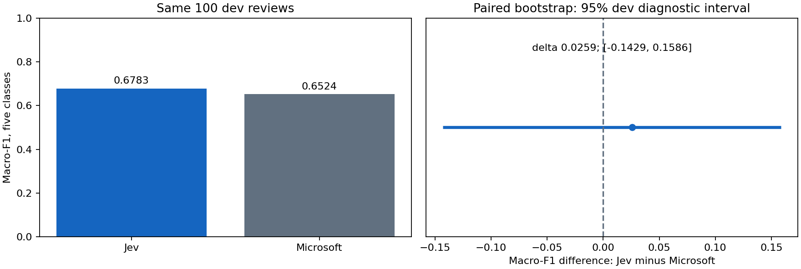

# Jev versus Microsoft: actual development capture

**Executed and reviewed 12 October 2026.** Jev completed 100/100 requests
without errors, retries, unknown costs or stopped pairs. Build
`typesafe/jev-1.13-20260917`, provider TypeSafe; source
`8d40e875e2aa3e8dcaec2cdd1dc84260cbd910bb`, notebook 24 from `23b7db7`.
CPU/API-only, isolated Python 3.13.15 and the pinned NumPy/SciPy/scikit-learn
versions in [runtime_preflight.json](runtime_preflight.json).

**The small Jev macro-F1 advantage does not establish superiority.** Its
paired difference is +0.02593, with a 95% dev bootstrap interval
[-0.14287, +0.15858]. Microsoft gets one more review correct overall.
No model was promoted, no Space changed and no test predictions were made
by this run or this review.

The same locked 100 dev reviews, five-way question and human labels are
used for both models. The Microsoft records are **exactly equal** to the
archived dated-build capture; no further Microsoft requests were made.
[verification.json](verification.json) records independent recomputation
of class counts/F1, accuracy, raw/calibrated ECE, Brier, log loss, referral
counts, retained errors, p95, cost, paired disagreements and the bootstrap.
Sample/label/source/capture/freeze hashes and every dev ID/fingerprint match.
The [extension protocol](../../JEV_EXTENSION.md) was declared before Jev
inference, after inspecting Microsoft dev; this remains development work.

| Measurement, same 100 dev reviews | Jev | Microsoft reference |
| --- | ---: | ---: |
| Raw macro-F1, all five classes | 0.6783 | 0.6524 |
| Accuracy | 64% | 65% |
| Raw ECE, 10 fixed equal-width bins | 0.2350 | 0.1483 |
| Dev-fitted ECE, in-sample | 0.0805 | 0.0619 |
| Raw retained at max probability >=0.7 | 79 | 69 |
| Raw errors among retained | 22/79 (27.85%) | 20/69 (28.99%) |
| Dev-calibrated retained at >=0.7 | 27 | 52 |
| Dev-calibrated errors among retained | 1/27 (3.70%) | 12/52 (23.08%) |
| Dev-calibrated human referrals | 73 | 48 |
| API request p95, ms | 480.583 | 668.567 |
| Provider-reported USD / 1,000 attempts | 0.0338856 | 0.0207564 |
| Provider-reported USD for these 100 attempts | 0.00338856 | 0.00207564 |

The software observed-spend limit chosen for this Jev run was USD 0.30.
All 100 attempts have reported cost. Scaling to USD/1,000 is sample
arithmetic, not a current tariff or spending forecast. Local compute cost
is unknown, not zero. Jev and Microsoft API timings come from different
sessions; the lower observed Jev p95 is not a controlled architecture-speed
result. The chart below shows the primary quality comparison only.

## Class support and what drives the difference

| Class | Gold support | Jev F1 | Microsoft F1 |
| --- | ---: | ---: | ---: |
| cleanliness | 1 | 1.0000 | 1.0000 |
| service | 18 | 0.7234 | 0.7442 |
| location | 14 | 0.5909 | 0.5652 |
| value | 3 | 0.4444 | 0.2857 |
| other | 64 | 0.6327 | 0.6667 |

Jev gets 2/3 value cases right, Microsoft 1/3. That single extra rare-class
correct prediction contributes materially to the macro-F1 difference;
the cleanliness result is based on one review. Jev overassigns named topics
to 33/64 gold-`other` cases, Microsoft to 30/64. `other` includes maintenance,
noise, food and amenities: it must never mean “no complaint or no action”.

There are only 11 discordant accuracy cases: Jev alone correct in 5,
Microsoft alone correct in 6. The declared bootstrap uses 2,000 paired
whole-review resamples, seed 20261012, all five classes and absent-class F1=0.
Its interval includes substantial advantages for either model. Sparse class
support and unverified reviewer independence limit inference.

## Confidence, abstention and the next decision

Jev's raw probabilities are more overconfident by ECE than Microsoft's in
this sample. Temperature 4.32418 was fitted on these same 100 dev examples;
the recorded Microsoft temperature is 1.30650. Calibration preserves class
argmax and overall accuracy but changes confidence and retained cases.
Raw Jev's 79 retained cases have 22 errors; after dev calibration only 27
are retained, with one error. These are **in-sample** risk/coverage estimates.
The lower error rate comes with substantially more human review and must
not be described as a 96.3% reliable system for new reviews.

An explicitly **post-hoc**, equal-count diagnostic retains the top 27
calibrated-confidence cases from each model (review-ID tie break): Jev
has 1/27 errors, Microsoft 4/27. This supports investigating selective use;
it is not a new threshold, a predeclared primary comparison or a deployment
decision. For perspective, the descriptive Wilson interval for 1/27 spans
about 0.66%--18.28%; fitting the rule on dev means even that interval is not
an independent guarantee.

Next: preserve these captures and the original human judgments. Predeclare
the final comparison and risk/coverage decision policy, freeze the model
IDs, exact question, source, temperatures and environment, then run the
untouched test once with explicit owner API opt-in/budget. Neither model
is an established winner now. The Jev extension freeze is not the final
four-arm test freeze; the Qwen precision caveat remains a separate issue
before any full four-arm evaluation.

The population is two NYC hotels in 2008--2009 and one primary topic per
review. No claim follows for current/unseen hotels, negative-complaint recall,
pending/resolved issues, exact quote evidence or useful hotel measures.
Those still need their own independent human evaluation before operational
integration into the experimental Space.

Archived files contain model outputs, timings/usage and aggregate evidence;
no review text, human annotation sheets, per-review gold or credentials.
[human_queue.csv](human_queue.csv) is a model-referral list, not another
rating task. The incoming ZIP and its source remain preserved separately.
